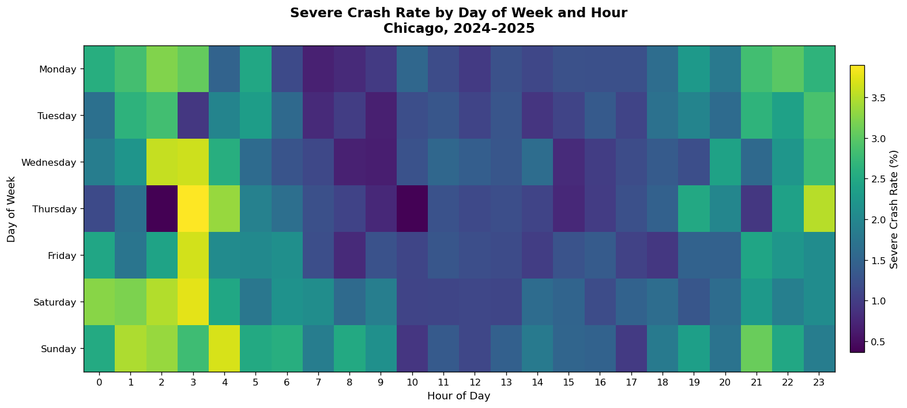

# Tang I Choi (MC631517)

Hi! I am a graduate student in Data Science at the University of Macau. I enjoy turning messy real-world data into clear, actionable insights through Python-based analysis and visualization.

## Skills

- **Programming**: Python (pandas, numpy, matplotlib, seaborn, geoplotlib)
- **Data Analysis**: Data cleaning, exploratory data analysis, statistical summarization
- **Visualization**: Static charts (matplotlib), spatial/geographic visualization, heatmaps
- **Tools**: Jupyter Notebook, Git & GitHub, GitHub Pages

## Projects

### Chicago Traffic Crash Severity Analysis (2024–2025)

**Research question**: What environmental, temporal, and demographic factors are associated with the severity of traffic crashes in Chicago during 2024–2025?

**What I did**: Analyzed 221,175 crash records from the Chicago Data Portal, examining how weather, lighting, road surface, speed limit, time of day, road-user type, and age relate to fatal or serious-injury outcomes.

**Key findings**:
- Severe crashes (fatal or serious injury) made up about **1.50%** of all crashes.
- Adverse conditions raised risk: rain (**1.97%** severe rate), dark-but-lighted roads (**2.37%**), and 36–40 mph zones (**3.72%**).
- Vulnerable road users were most at risk: pedestrians (**14.34%**), motorcyclists (**13.39%**), and cyclists (**7.53%**).

**Visualizations**:

This heatmap shows the share of crashes classified as severe (fatal or serious injury) by the combination of weather and lighting conditions in Chicago, 2024–2025. Rain paired with dark, lighted roads produced the highest severe-crash rates (up to ~2.9%), and rainy conditions overall were riskier (1.97%) than clear weather (1.60%). Crashes at night were consistently more dangerous than in daylight, highlighting the combined effect of reduced visibility and adverse weather.

This heatmap displays the severe-crash rate (fatal or serious injury, %) across the day of the week and hour of day for Chicago, 2024–2025. Severe-crash risk peaks in the late-night and early-morning hours, reaching about 3.1% around 2–3 a.m., and Sundays show the highest daily average (2.01%). In contrast, weekday daytime commuting hours record the lowest rates, pointing to overnight and weekend late-night driving as elevated-risk windows.

[View project repository](https://github.com/mc63151-code/data-science-project)

**Status**: Completed

## Contact

- GitHub: [mc63151-code](https://github.com/mc63151-code)
